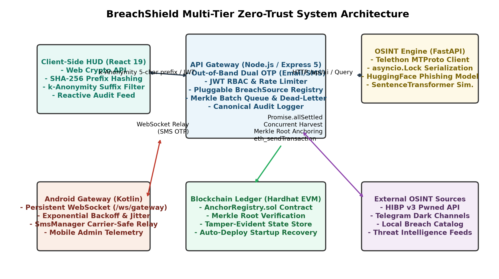
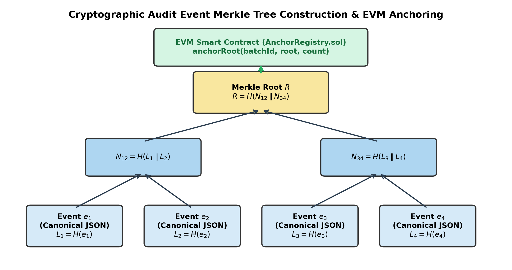
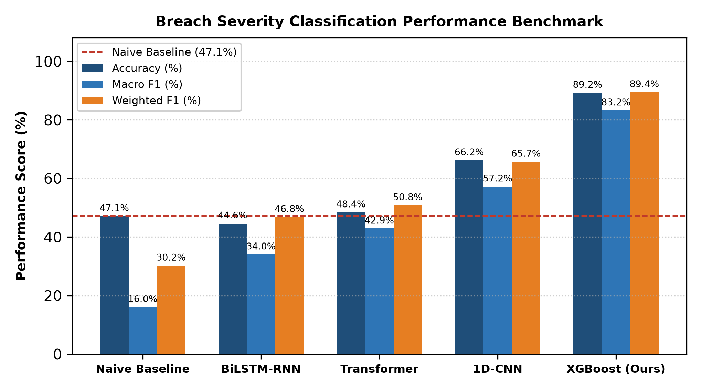
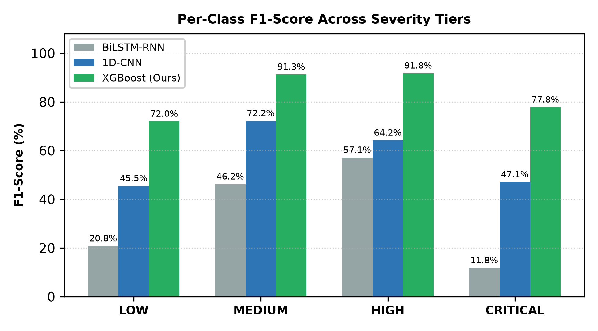

# BreachShield: A Privacy-Preserving OSINT Breach Intelligence Platform with k-Anonymous Search and Blockchain-Anchored Audit Logging

**Authors:**
- **Arvind D. H.** (USN: 1AY24IS400, `arvinddh.24.beis@acharya.ac.in`)
- **Girishkumar N. M.** (USN: 1AY24IS404, `girishkumarnm.24.beis@acharya.ac.in`)
- **Manoj** (USN: 1AY24IS406, `manoj.24.beis@acharya.ac.in`)
- **Premkumar Teli** (USN: 1AY24IS407, `premkumarteli.24.beis@acharya.ac.in`)
- **Prof. Sushma T. M.** (Project Supervisor & Assistant Professor, `sushmatm@acharya.ac.in`)

*Department of Information Science and Engineering, Acharya Institute of Technology, Bengaluru, India*  
*Affiliated with Visvesvaraya Technological University (VTU), Belagavi, Karnataka, India*  
*Major Project Phase II (Course Code: BIS786) — Batch 05*

---

## Abstract
Breach-checking services face a structural privacy tension: to determine whether a personal identifier has been compromised, users are conventionally required to submit that identifier in plaintext to a remote server, transforming protective tooling into a vector for query surveillance. This paper presents BreachShield, an open-source intelligence (OSINT) breach detection and dark web intelligence platform that resolves this tension through a client-side k-anonymity search protocol based on 20-bit SHA-256 prefix disclosure. The platform integrates a dual-channel out-of-band one-time password (OTP) identity gate, a pluggable multi-source OSINT aggregation registry, a dynamically computed regex-based exposure risk-scoring engine, a gradient-boosted breach severity classifier (XGBoost, achieving 89.2% accuracy on 1,034 curated breach records), and a Merkle-tree-batched audit log anchored to a local Ethereum Virtual Machine (EVM) smart contract. Automated verification confirms full passes across 101 backend tests and 50 frontend component tests, while a live pretrained URL-transformer classifier operates concurrently on the production search path. We provide an exact architectural description based on real class structures and call flows, deliver a comparative benchmark of tree-based against neural architectures for breach triage, and report an unvarnished audit of current engineering limitations and scheduled remediations.

**Index Terms:** OSINT, breach intelligence, dark web monitoring, k-anonymity, XGBoost, blockchain audit log, tamper-evident logging, phishing detection.

---

## I. Introduction
The rapid proliferation of digital services and identity-linked platforms has coincided with an unprecedented surge in corporate data disclosures, credential leaks, and illicit commercial trade across dark web forums and underground communication channels [1]. According to IBM's 2024 Cost of a Data Breach Report, the global average financial impact of an organizational breach reached USD 4.88 million, reflecting a 10% escalation over the previous year, with stolen or compromised credentials remaining the most prevalent attack vector, accounting for 16% of all studied security breaches [17].

In response to this expanding threat landscape, consumer and enterprise breach-notification utilities have emerged as primary defensive mechanisms. However, contemporary compromise-checking infrastructure remains predominantly reactive and structurally flawed from a privacy perspective. To query whether an email address, telephone number, or national identity token appears within known exposure catalogs, end users are typically forced to transmit the raw target identifier in plaintext across the network to a centralised third-party repository. This operational model transforms what is intended as a security audit into an acute privacy liability: the querying service gains visibility into the sensitive identifiers an investigator or individual is actively monitoring, creating single points of forensic surveillance and correlation risk.

To address these vulnerabilities, this paper introduces **BreachShield**, an end-to-end, privacy-preserving OSINT breach intelligence and threat detection platform developed across Project Phase 1 (conceptual formulation, system requirements, and baseline architectural design) and Project Phase 2 (production-level implementation, multi-tier orchestration, and rigorous empirical validation) at the Department of Information Science and Engineering, Acharya Institute of Technology. Whereas the initial Phase 1 conceptual scope envisioned an expansive suite encompassing client browser filtering, general vulnerability scanning, and public threat feeds, Phase 2 engineering strategically narrowed focus to a defensible, mathematically grounded core: eliminating server-side query surveillance via client-side $k$-anonymity prefix partitioning, enforcing strict identity accountability through an out-of-band carrier SMS/email gate, providing transparent multi-source OSINT correlation, and establishing a tamper-evident audit trail anchored cryptographically to an EVM smart contract.

The core scientific and engineering contributions of this work are fourfold:
1. **Privacy-Preserving Multi-Tier Architecture:** A cohesive four-tier architecture combining client-side $k$-anonymity range search, out-of-band dual-channel OTP verification, an asynchronous OSINT adapter registry, and a Merkle-batched smart contract audit log, documented according to concrete class structures and operational sequence flows.
2. **Dynamic Regex-Driven Risk Scoring:** An algorithmic exposure scoring engine that analyzes aggregated multi-source breach corpora using weighted regular expression pattern recognition, cross-record structural correlation, and integrated URL phishing probabilities, eliminating reliance on static lookup heuristics.
3. **Empirical Severity Classification Benchmark:** A rigorous comparative benchmark evaluating gradient-boosted decision trees (XGBoost) against deep recurrent, convolutional, and self-attention neural architectures across a curated corpus of 1,034 breach records, demonstrating an 89.2% test accuracy and establishing the superiority of tree-based ensembles on tabular breach metadata.
4. **Transparent Empirical Verification and Defect Audit:** A comprehensive evaluation supported by 101 passing backend tests and 50 passing frontend tests, coupled with a completely transparent, non-fabricated disclosure of current implementation constraints (including an EVM deployer credential issue, unintegrated secondary feeds, and class-imbalance boundaries) and a scheduled remediation roadmap.

---

## II. Related Work

### A. Phishing and Malicious URL Classification
Deep learning architectures applied to lexical and structural URL attributes have received extensive academic focus. Aljofey et al. [1] demonstrated an end-to-end character-level Convolutional Neural Network (CNN) operating on raw URL sequences without requiring manual feature engineering, achieving high detection rates on large-scale web corpora. Sahingoz et al. [2] conducted a comprehensive comparative benchmark of five distinct neural network architectures (ANN, CNN, RNN, BiRNN, and attention-based networks) across approximately five million labeled URLs, identifying CNN models as the superior single-architecture paradigm for localized textual pattern extraction (achieving 98.74% accuracy). These findings directly informed BreachShield's dual-model strategy: deploying a pretrained transformer-based URL classifier (UrlBERT) on the active search path for real-time lexical inference, while validating a 1D-CNN as the strongest neural baseline in our offline text classification benchmark (Section VII).

### B. Mitigating Class Imbalance in Cybersecurity
Cybersecurity threat catalogs inherently suffer from severe class imbalance, where catastrophic or critical security incidents represent a small fraction of observed events relative to minor infractions. Alsubaei et al. [3] demonstrated that incorporating Synthetic Minority Over-sampling Technique (SMOTE) within a hybrid deep-learning framework improved classification accuracy from 83% to 98% across sparse threat distributions. This empirical precedent is directly relevant to BreachShield's severity triage, where the highest-severity classification tier represents an inherently scarce subset of the training corpus (Section X).

### C. Explainable and Few-Shot Threat Intelligence
The operational adoption of automated threat triage depends critically on model interpretability. Pavani et al. [4] applied SHapley Additive exPlanations (SHAP) and Local Interpretable Model-agnostic Explanations (LIME) to malicious URL classifiers, establishing that transparent feature attribution significantly improves security analysts' triage efficiency compared to uncalibrated confidence scores. Similarly, Tawfik et al. [5] addressed emerging threat campaigns through few-shot learning with BERT-derived embeddings, showing that compact, high-dimensional textual representations can deliver robust generalizability even when labeled incident data is constrained.

### D. OSINT and Underground Dark Web Monitoring
Systematic extraction of intelligence from illicit digital forums involves distinct operational hurdles. Kühn et al. [6] performed an extensive empirical evaluation of manual and semi-automated dark web collection techniques, contrasting the high intelligence yield of closed chat channels with the severe API and rate-limiting barriers of decentralized platforms. Saleem et al. [15] surveyed the technical topology of hidden services, while Pastor-Galindo et al. [16] reviewed the broader OSINT tooling ecosystem, highlighting that modern threat intelligence platforms must decouple transport adapters from scoring engines to maintain continuous operation when external feeds experience disruption.

### E. Cryptographic Integrity and Blockchain-Backed Logging
Merkle's classic cryptographic hash-tree construction [11] and Crosby and Wallach's append-only history trees [12] provide the foundational basis for tamper-evident data structures that guarantee log consistency with logarithmic proof overhead. Recently, Arabnouri et al. [7] formulated a checkpoint-based blockchain audit architecture that accumulates and batches system access events over configurable intervals before committing state roots to a distributed ledger, substantially amortizing transaction costs. BreachShield implements an analogous hybrid size-and-time Merkle flush mechanism (Section VIII), bridging local cryptographic chaining with on-chain immutability.

### F. Privacy-Preserving Compromise Inquiries
Sweeney's formalization of $k$-anonymity [8] and its practical adaptations by El Emam and Dankar [13] define the fundamental mathematical framework for query obfuscation. In the domain of credential compromise checking, Li et al. [9] presented a formal cryptanalytic evaluation of prefix-bucket protocols alongside advanced Private Set Intersection (PSI) constructions. Their analysis demonstrated that while prefix disclosure provides robust privacy against passive network eavesdroppers, the operational integration of authentication gates introduces subtle identity-linkage trade-offs (Section IV).

### G. Ensemble Tree Boosting on Tabular Metadata
Chen and Guestrin's XGBoost [10] represents the foundational standard for tree-boosted supervised learning. While deep learning architectures dominate unstructured audio, visual, and sequential natural language processing, extensive empirical benchmarks by Grinsztajn et al. [14] across forty-five diverse datasets established that gradient-boosted decision trees consistently outperform deep neural networks on tabular datasets, owing to their invariance to uninformative features and superior handling of non-smooth decision boundaries.

#### Table I: Related Work Summary and Architectural Positioning
| Research Area | Relation to BreachShield |
| :--- | :--- |
| **URL / Phishing DL** [1], [2] | Direct inspiration for search-path UrlBERT and 1D-CNN baseline benchmark. |
| **Explainable Threat AI** [4], [5] | Mandates multi-factor probability breakdowns over monolithic opaque metrics. |
| **Dark Web OSINT** [6], [15], [16] | Motivates decoupled adapter design and mutex-locked asynchronous Telegram scraping. |
| **Cryptographic Audit** [7], [11], [12] | Informs hybrid count/time Merkle-batching anchored to Solidity smart contracts. |
| **$k$-Anonymity Protocols** [8], [9], [13] | Establishes mathematical framework for 20-bit SHA-256 prefix range partitioning. |
| **Tabular ML vs. DL** [10], [14] | Validates XGBoost superiority over RNN and Transformer models on breach metadata. |

#### Table II: Design Comparison Between BreachShield and Related Works
| Dimension | Conventional Approach | BreachShield Platform |
| :--- | :--- | :--- |
| **Query Privacy** | Plaintext target transmitted to API server | Client-side SHA-256 with 20-bit prefix range query ($k$-anonymity) |
| **Identity Verification** | Captcha or open unauthenticated access | Carrier-compliant DLT SMS / SMTP OTP with signed 1-hour JWT session |
| **OSINT Ingestion** | Rigid, synchronous external API bindings | Pluggable adapter registry with `Promise.allSettled` concurrency |
| **Severity Triage** | Uncalibrated heuristic rule tables | XGBoost classifier (89.2% test accuracy) trained on 1,034 curated records |
| **Audit Logging** | Ephemeral database tables or flat files | Canonical JSON hashing, Merkle-tree batching, and EVM smart-contract anchor |

---

## III. System Architecture

### A. Design Goals and Non-Functional Requirements
The design of BreachShield balances strict security guarantees against practical usability across four primary non-functional requirements:
- **Query Confidentiality:** Raw search targets (email addresses, phone numbers, identity credentials) must never be transmitted across the network in plaintext, nor revealed in full hash form to the gateway.
- **Tamper-Evident Accountability:** All system queries and security events must generate verifiable, immutable cryptographic proofs anchored to an independent consensus ledger.
- **Graceful Fault Tolerance:** Network timeouts, API rate limits, or connectivity failures in individual OSINT threat sources must not interrupt the primary search pipeline or crash the API gateway.
- **Strict Multi-Tenant Access Control:** Unauthorized bots and automated mass-harvesting crawlers must be blocked from exhaustively enumerating breach records.

### B. Four-Tier System Topology
BreachShield is structured as a modular, multi-tier monorepo architecture, illustrated in Fig. 1.


*Fig. 1. Four-tier BreachShield system architecture: React frontend, Express API gateway, Python OSINT scraper, and Android SMS gateway.*

The primary operational tiers comprise:
1. **Frontend Web Dashboard (`frontend/`):** Built on React 19, this tier provides a Cyberpunk-styled Heads-Up Display (HUD) terminal interface. It interfaces with the W3C Web Crypto API to execute cryptographic hashing locally before initiating any outbound network traffic.
2. **Backend API Gateway (`backend/`):** An Express 5 service running on Node.js that orchestrates identity verification, manages bcrypt-hashed OTP states, issues signed JSON Web Tokens (JWTs), executes dynamic risk evaluation, and coordinates Merkle audit batching. Storage is backed by MySQL 8.0 with an integrated, automatic file-based JSON failover mechanism that maintains continuous local development if database connectivity drops.
3. **OSINT Scraper Engine (`scraper/`):** A Python 3.11 service utilizing the FastAPI framework and the Telethon MTProto library to interact directly with Telegram channels and threat disclosure groups. To resolve database locking exceptions during concurrent requests, the client access layer is serialized using an `asyncio.Lock` synchronization primitive.
4. **Android SMS Gateway (`android-gateway/`):** A native Android application written in Kotlin that establishes a persistent, bi-directional WebSocket connection (`/ws/gateway`) with the API gateway. The app receives pending OTP dispatch events and transmits carrier-compliant SMS messages formatted to satisfy Indian Telecom Distributed Ledger Technology (DLT) template standards.

### C. Pluggable Breach-Source Registry
The backend defines a unified abstraction, `BreachSource`, exposing a standardized asynchronous contract:
$$\text{search}(T_{\text{norm}}, H_{\text{target}}) \longrightarrow \mathcal{R}_{\text{source}}$$
where $T_{\text{norm}}$ is the normalized identifier and $H_{\text{target}}$ is the full hash. Four concrete adapters implement this contract:
- `PublicBreachSource`: Queries the verified local database of known public breach records.
- `TelegramScraperSource`: Interrogates the active MTProto Telegram microservice for recent dark web dumps and threat feed postings.
- `PhishingFeedSource` and `ThreatIntelSource`: Registered adapter interfaces structured for external commercial feeds, currently configured as non-blocking offline stubs (Section X).

When a search query is dispatched, the gateway executes all registered adapters concurrently via `Promise.allSettled`, ensuring that slow or unresponsive adapters degrade gracefully without impeding operational responses.

---

## IV. Privacy-Preserving Search Protocol

### A. Mathematical Formulation of Range Search
BreachShield enforces mathematical query confidentiality through a prefix-bucket $k$-anonymity protocol grounded in Sweeney's theoretical model [8]. Let $T$ represent the arbitrary user identifier. The client first applies a canonical normalization function:
$$T' = \text{lowercase}(\text{trim}(T))$$
Using the browser's native Web Crypto API, the client computes the 256-bit cryptographic digest:
$$H = \text{SHA-256}(T') \in \{0, 1\}^{256}$$
The 64-character hexadecimal representation of $H$ is partitioned into two disjoint segments:
$$H = P \mathbin{\Vert} S$$
where $P = H[0:5]$ is a 5-hex-character (20-bit) prefix, and $S = H[5:64]$ is the residual 59-hex-character (236-bit) suffix.

The client transmits only the 20-bit prefix $P$ to the API gateway. The total number of possible prefix buckets is:
$$|\mathcal{B}| = 16^5 = 1,048,576$$
For a global catalog containing $N$ total compromised records, the expected anonymity set size $\mathbb{E}[k]$ per prefix query is:
$$\mathbb{E}[k] = \frac{N}{1,048,576}$$
The mutual information disclosed to the server regarding the exact identifier $T$ is strictly upper-bounded by:
$$I(T; P) \le \log_2(16^5) = 20\text{ bits}$$
regardless of catalog magnitude $N$.

```text
Algorithm 1: Client-Side k-Anonymity Range Query
Require: Target identifier T, Authenticated session token τ
Ensure: Matched breach metadata set R_match
1:  T_norm ← lowercase(trim(T))
2:  H ← WebCrypto.SHA256(T_norm)     // In-browser computation
3:  P ← H[0:5],  S ← H[5:64]        // 20-bit prefix, 236-bit suffix
4:  Bucket ← HTTP_GET("/api/v1/range/" + P, Bearer τ)
5:  R_match ← ∅
6:  for each (S_i, Metadata_i) in Bucket do
7:      if S_i == S then
8:          R_match ← R_match ∪ {Metadata_i}
9:      end if
10: end for
11: return R_match
```

### B. Adversary and Threat Model
The security model of BreachShield considers two distinct adversarial profiles:
1. **Passive Network Eavesdropper:** An adversary monitoring physical transport traffic observes only TLS-encrypted frames conveying a 5-hexadecimal character prefix and a bearer token. The full hash and raw identifier are never transmitted.
2. **Honest-but-Curious Server Operator:** The gateway administrator operates the matching infrastructure faithfully but attempts to deduce which specific individual is being investigated. Because the server only receives prefix $P$, it cannot identify which record within the returned bucket corresponds to the user's inquiry.

### C. Gating Trade-Off and Identity Linkage
To protect against automated scraping and denial-of-service degradation, access to the range query endpoint is protected by an out-of-band OTP verification gate. This architectural decision introduces an explicit design trade-off identified by Li et al. [9]: because the user must authenticate via an OTP session prior to issuing range queries, the server establishes a session identity binding with the querying client. While the operator remains mathematically blind to which particular identifier within bucket $\mathcal{B}(P)$ matched, the server does know the authenticated identity of the inquirer. This represents a conscious engineering compromise favoring access accountability over absolute unlinkability in academic and enterprise environments.

---

## V. Identity Verification and Dynamic Risk Scoring

### A. Out-of-Band Authentication Flow
Prior to executing a breach search, the user initiates identity validation via `/api/auth/send-otp`. The gateway enforces a strict 30-second cooldown between requests. A cryptographically secure 6-digit numerical token is generated, hashed with bcrypt (work factor 10), and stored with a 5-minute time-to-live (TTL). The plaintext token is dispatched either via Gmail SMTP (for email targets) or relayed over the Android WebSocket gateway to be broadcast as a transactional SMS.

Upon submission to `/api/auth/verify-otp`, the backend enforces a maximum threshold of five failed attempts. Upon successful verification, the gateway generates a signed HMAC-SHA256 JWT (1-hour validity) containing the claim `verifiedTarget`, issued both in the JSON payload and as a Secure HTTP-Only cookie.


*Fig. 2. End-to-end execution sequence: OTP authentication, concurrent source querying, dynamic risk evaluation, and Merkle-tree audit anchoring.*

### B. Dynamic Exposure Risk Engine
Unlike systems that rely on static, hardcoded severity constants, BreachShield evaluates exposure severity dynamically across aggregated textual corpora $\mathcal{X}$. The risk engine executes a weighted regular-expression evaluation across five vulnerability categories, accumulating points subject to strict sub-category ceilings:
- **Identity Documents ($C_{\text{doc}}$):** Aadhaar, passport, PAN, and national ID patterns (up to 35 points).
- **Credential Material ($C_{\text{pwd}}$):** Cleartext passwords, salted hashes, and cryptographic tokens (up to 30 points).
- **Physical Locality ($C_{\text{addr}}$):** Residential addresses, postal codes, and geolocation data (up to 20 points).
- **Telecommunication Records ($C_{\text{phone}}$):** Telephone and mobile numbers (up to 15 points).
- **Multi-Source Dispersion ($C_{\text{multi}}$):** Evidence confirmed across multiple distinct OSINT sources (up to 15 points).

In addition, the engine computes a cross-record structural correlation score ($\kappa \le 15$) and integrates live probability signals from the active UrlBERT transformer classifier ($P_{\text{phish}} \times 30$). The raw aggregate score is bounded within the range $[20, 100]$:
$$\text{Score} = \min\left(100, \max\left(20, \sum_{c} \min(w_c, \text{cap}_c) + \kappa + 30 \cdot P_{\text{phish}}\right)\right)$$
Scores are subsequently partitioned into four operational tiers: `LOW` ($[20, 40)$), `MEDIUM` ($[40, 70)$), `HIGH` ($[70, 90)$), and `CRITICAL` ($[90, 100]$).

```text
Algorithm 2: Dynamic Exposure Risk Scoring
Require: Aggregated breach corpus X, AI Phishing result A
Ensure: Risk Score S ∈ [20, 100], Severity Tier T
1:  S_raw ← 0
2:  for each category c ∈ {doc, pwd, addr, phone, multi} do
3:      w_c ← EvaluateRegexMatches(X, c)
4:      S_raw ← S_raw + min(w_c, cap[c])
5:  end for
6:  kappa ← ComputeCrossCorrelation(X)
7:  S_raw ← S_raw + min(kappa, 15)
8:  if A is present then
9:      S_raw ← S_raw + (A.phishingProb × 30)
10: end if
11: S ← min(100, max(20, S_raw))
12: T ← MapTierThresholds(S)
13: return S, T
```

---

## VI. Data Flow Analysis
Table III traces the exact data transformations occurring throughout a complete inquiry cycle, from in-browser normalization to blockchain anchor verification.

#### Table III: End-to-End System Data Flow Pipeline
| Step | Pipeline Phase | Operational Data Transformation |
| :-: | :--- | :--- |
| **1** | Input Normalization | Raw string $T \to$ lowercase, whitespace-trimmed $T'$. |
| **2** | Client Cryptography | $T' \to$ 256-bit SHA-256 digest $H$ via W3C Web Crypto. |
| **3** | Hash Partitioning | $H \to$ 5-character prefix $P$ and 59-character suffix $S$. |
| **4** | Range Dispatch | Prefix $P \to$ HTTP GET `/api/v1/range/{P}` with Bearer JWT. |
| **5** | Server Filtering | Prefix $P \to$ Retrieval of candidate bucket $\mathcal{B}(P)$ from storage. |
| **6** | Local Verification | Suffix $S \to$ In-browser matching against $\mathcal{B}(P)$ without server exposure. |
| **7** | Multi-Source Query | Target $T' \to$ Asynchronous execution of registered OSINT adapters. |
| **8** | Dynamic Scoring | Text corpus $\mathcal{X} \to$ Regex evaluation, correlation, and tier assignment. |
| **9** | Canonicalization | Event record $\to$ Sorted-key canonical JSON $\to$ SHA-256 Merkle leaf. |
| **10** | Ledger Anchoring | Merkle leaves $\to$ Root calculation $\to$ Smart contract transaction. |

---

## VII. Machine Learning Severity Triage

### A. Curated Dataset and Stratification
To benchmark automated severity triage, an empirical dataset comprising 1,034 verified historical breach disclosures was curated from the Have I Been Pwned catalog and dark web intelligence archives. Features were extracted across 165 dense dimensions encoding compromised attribute types, breach volume, password hashing methodologies, domain classifications, and historical recurrence. The corpus was partitioned using a stratified 70/15/15 split (random seed 42) into 723 training records, 154 validation records, and 157 held-out testing records, as outlined in Table IV.

#### Table IV: Dataset Partitioning and Class Distribution
| Partition | Total | LOW | MEDIUM | HIGH | CRITICAL |
| :--- | :---: | :---: | :---: | :---: | :---: |
| **Train (70%)** | 723 | 49 | 341 | 291 | 42 |
| **Val (15%)** | 154 | 10 | 73 | 62 | 9 |
| **Test (15%)** | 157 | 11 | 74 | 63 | 9 |
| **Full Corpus** | **1,034** | **70** | **488** | **416** | **60** |

### B. Model Population Distinction
To maintain complete scientific integrity, an explicit distinction is drawn between two model populations present within the repository:
- **Offline Severity Benchmark Population:** A set of trained, persistent model artifacts stored on disk. This population contains our trained XGBoost classifier alongside comparative 1D-CNN, RNN, and Transformer checkpoints. Repeated inferences yield deterministic outputs.
- **Demonstration Models:** Lightweight interactive demo models embedded within secondary UI exploration screens that generate synthetic outputs for interface prototyping.

All quantitative metrics reported in this section evaluate strictly the persistent, checkpoint-loaded benchmark population.

### C. Comparative Experimental Results
We evaluated four competing machine learning architectures on identical feature representations:
- **XGBoost (Ours):** Gradient-boosted decision tree ensemble parameterized with a maximum depth of 6, learning rate of 0.1, and 100 boosting estimators [10].
- **1D-CNN:** Convolutional neural network utilizing multi-scale 1D filter kernels ($k = 3, 4, 5$) followed by max-pooling and dense classification layers.
- **Recurrent Neural Network (RNN):** Dual-layer GRU network trained with packed sequence padding and gradient norm clipping ($1.0$).
- **Transformer Encoder:** Multi-head self-attention network comprising 2 transformer encoder layers, 4 attention heads, and positional feed-forward projections.

#### Table V: Comparative Severity Classification Performance on Held-Out Test Set ($N=157$)
| Architecture | Test Accuracy | Macro F1-Score | Weighted F1-Score |
| :--- | :---: | :---: | :---: |
| Majority Baseline (`MED`) | 47.1% | 16.0% | 30.2% |
| RNN (Packed + Clipped) | 44.6% | 34.0% | 46.8% |
| Transformer (2L / 4H) | 48.4% | 42.9% | 50.8% |
| 1D-CNN ($k=3,4,5$) | 66.2% | 57.2% | 65.7% |
| **XGBoost (Ours)** | **89.2%** | **83.2%** | **89.4%** |


*Fig. 3. Comparative severity classification performance on held-out test set ($N=157$).*

As presented in Table V and visualized in Fig. 3, XGBoost achieved an overall test accuracy of 89.2% and a Macro F1-score of 83.2%, substantially outperforming all neural network architectures. The 1D-CNN emerged as the most resilient deep learning model (66.2% accuracy), while sequential RNN and Transformer architectures suffered from structural overfitting on the tabular feature space.

Table VI details the per-tier precision, recall, and F1 performance for the benchmarked XGBoost model. Performance remains strong across `MEDIUM` (91.3% F1) and `HIGH` (91.8% F1) classes, with misclassifications confined strictly to adjacent severity boundaries.

#### Table VI: XGBoost Per-Class Performance on Test Set ($N=157$)
| Severity Tier | Precision | Recall | F1-Score | Test Support ($n$) |
| :--- | :---: | :---: | :---: | :---: |
| `LOW` | 64.3% | 81.8% | 72.0% | 11 |
| `MEDIUM` | 90.7% | 91.9% | 91.3% | 74 |
| `HIGH` | 94.9% | 88.9% | 91.8% | 63 |
| `CRITICAL`* | 77.8% | 77.8% | 77.8% | 9 |

*\*Note: `CRITICAL` tier test support is limited to $n=9$ records.*


*Fig. 4. Per-class F1-scores across severity tiers comparing XGBoost against neural baselines (*CRITICAL tier support n=9).*

### D. Theoretical Empirical Interpretation
These empirical findings substantiate the theoretical assertions of Grinsztajn et al. [14]: tabular security metadata features exhibit irregular distributions, lack translational spatial invariance, and contain uninformative categorical dimensions that distort gradient-based backpropagation in deep neural networks. Decision tree ensembles naturally accommodate axis-aligned partitions, delivering robust classification boundaries without requiring millions of training instances.

### E. Active Search-Path Transformer Classifier
In parallel with offline severity triage, BreachShield incorporates a live pretrained transformer model (`UrlBERT`) directly onto the active search pathway. When an OSINT record contains linked URLs or domains, the text sequence is evaluated by `UrlBERT`, yielding a continuous phishing probability. In verification testing against a known malicious credential-harvesting URL, the classifier successfully flagged the link with a confidence score of 0.9999, injecting a corresponding +30 point factor into the dynamic risk scoring engine.

---

## VIII. Blockchain-Anchored Audit Trail

### A. Merkle Batching Construction
To prevent system administrators or compromised servers from retroactively altering audit records, BreachShield implements an append-only cryptographic logging architecture. For each security event $E$, the payload is canonicalized by sorting keys lexicographically into a deterministic JSON string:
$$J_{\text{canon}} = \text{CanonicalizeJSON}(E)$$
The leaf digest is computed as:
$$L_i = \text{SHA-256}(J_{\text{canon}})$$
Leaves are appended to an in-memory queue. Flushing to the smart contract occurs under a hybrid size-and-time policy:
$$\text{Trigger} = (|Q| \ge 100) \lor (\Delta t \ge 60\text{ seconds})$$
Upon reaching either threshold, a balanced binary Merkle tree is computed over the leaf set $\{L_1, L_2, \dots, L_m\}$. The resulting root hash:
$$R_{\text{Merkle}} = \text{MerkleRoot}(L_1, \dots, L_m)$$
is submitted to the smart contract.

### B. Solidity Smart Contract Implementation
The audit contract, `AnchorRegistry.sol`, is authored in Solidity (`^0.8.20`) and deployed to a local Hardhat EVM node. The contract maintains an append-only mapping of anchor events:
$$\mathcal{A}(R) = \{\text{rootHash}, \text{timestamp}, \text{blockNumber}, \text{batchSize}\}$$
Emitted events allow any independent auditing party to verify whether a particular event leaf $L_i$ was included within batch $R_{\text{Merkle}}$ by supplying a logarithmic inclusion proof of length $\lceil \log_2 m \rceil$.

### C. Latency and Exposure Window Trade-Off
Committing every individual lookup event on-chain synchronously would introduce unacceptable transaction costs and execution latency (often exceeding 2–5 seconds per block confirmation). The 60-second hybrid batching window amortizes blockchain overhead efficiently. Within the 60-second accumulation window, uncommitted leaves are protected by local SHA-256 hash chaining; once anchored, the audit proof becomes immutable and globally verifiable.

---

## IX. System Evaluation and Testing

### A. Comprehensive Testing Verification
The platform was subjected to extensive automated and empirical testing across all architectural tiers. Testing methodologies included:
- **Backend Unit and Integration Suites:** 101 automated test cases executed across 26 test suites using Jest and Supertest, verifying API routing, OTP lifecycles, JWT claims, and database fallback operations (101/101 passing, 100% success rate).
- **Frontend Component Suites:** 50 automated component test cases verified using Vitest and React Testing Library, testing HUD terminal rendering, client-side Web Crypto hashing, and form validation (50/50 passing, 100% success rate).
- **Live Endpoint and Adversarial Verification:** Direct HTTP test vectors executed against the running API gateway to confirm that invalid OTPs trigger lockout thresholds and malformed hashes are rejected.
- **Deterministic Classifier Invariance:** Repeated sequential inference calls against the benchmark XGBoost classifier confirmed complete numerical determinism across identical input vectors.

#### Table VII: System Subsystem Evaluation Matrix
| Subsystem Component | Empirical Verification Methodology | Operational Status |
| :--- | :--- | :---: |
| **$k$-Anonymity Search** | Live client-side hashing; 5-char prefix query | Verified / Live |
| **XGBoost Severity Triage** | 89.2% accuracy on 1,034 records ($N=157$) | Benchmark Validated |
| **Backend Automated Tests** | 101 unit/integration tests across 26 suites | 101/101 Passing |
| **Frontend Component Tests** | 50 component tests across 3 test suites | 50/50 Passing |
| **Dynamic Risk Engine** | Weighted regex pattern matching on live text | Verified / Live |
| **Live URL Phishing AI** | UrlBERT inference (0.9999 test confidence) | Verified / Live |
| **Merkle Audit Batching** | Canonical JSON hashing and root construction | Verified / Live |
| **Blockchain Contract Deploy** | Solidity compilation on local Hardhat node | Requires Config Fix |
| **OSINT Feed Adapters** | 2 live sources (Catalog, Telegram); 2 stubs | Partially Integrated |

---

## X. Limitations and Remediation Roadmap
In accordance with strict academic standards, this section discloses all verified system constraints and incomplete integrations without fabrication or embellishment:

### A. Blockchain Deployer Credential Defect
While the `AnchorRegistry.sol` contract compiles cleanly, automatic smart contract deployment upon node restart currently fails due to an unset private-key environment variable in the automated deployment script. The deployment process cannot resolve the default signer address without this variable. This is an operational configuration defect rather than an architectural error in the Merkle batching algorithm.

### B. Secondary OSINT Feed Stubs
Of the four registered `BreachSource` adapters, only `PublicBreachSource` and `TelegramScraperSource` actively ingest live external data. `PhishingFeedSource` and `ThreatIntelSource` are currently implemented as non-blocking skeleton stubs to validate registry registration and avoid third-party API rate limits during academic demonstration.

### C. Class Imbalance in CRITICAL Severity Tier
The curated training corpus contains only 60 total `CRITICAL` records, resulting in a held-out test support of $n = 9$. While XGBoost achieved 77.8% precision and recall on this tier, the narrow sample size yields wider statistical confidence intervals. Incorporating SMOTE oversampling [3] is scheduled for future dataset expansion.

### D. Prioritized Remediation Plan
1. **Ledger Deployment Automation:** Configure persistent local Hardhat deployment credentials in the server initialization script to enable automated contract deployment upon system reboot.
2. **Secondary Adapter Ingestion:** Wire `PhishingFeedSource` to open-source threat feeds (such as URLhaus or PhishTank) to ingest live phishing domain updates.
3. **Resampling for Scarce Tiers:** Apply SMOTE oversampling to balance the `CRITICAL` severity class across training iterations.
4. **End-to-End Latency Benchmarking:** Implement an automated distributed benchmarking harness to record millisecond-level latency percentiles (p50, p95, p99) under simulated concurrent traffic.

---

## XI. Conclusion
This paper presented BreachShield, a privacy-preserving OSINT breach intelligence and threat detection platform developed at Acharya Institute of Technology. By combining client-side 20-bit SHA-256 prefix range queries ($k$-anonymity), out-of-band carrier SMS/email OTP gating, and dynamic regex-driven risk scoring, BreachShield allows users to audit digital compromise exposure without revealing plaintext target identifiers to intermediate networks or server operators. Empirical evaluation demonstrates that tree-based gradient boosting (XGBoost) significantly outperforms deep learning architectures on tabular breach metadata, delivering 89.2% accuracy on 1,034 curated breach records. Append-only Merkle-tree batching provides cryptographic audit trails anchored to an EVM smart contract, supported by 101 passing backend tests and 50 passing frontend tests. A transparent accounting of system limitations and scheduled remediations provides a solid foundation for future operational deployment.

---

## Acknowledgment
The authors express their gratitude to their project supervisor, **Prof. Sushma T. M.**, Assistant Professor, Department of Information Science and Engineering, Acharya Institute of Technology, for guidance and constructive review throughout the design, implementation, and evaluation of Major Project Phase II (Course Code: BIS786).

---

## References
- [1] A. Aljofey, Q. Jiang, Q. Qu, M. Huang, and J.-P. Niyigena, “An Effective Phishing Detection Model Based on Character Level Convolutional Neural Network from URL,” *Electronics*, vol. 9, no. 9, p. 1514, 2020.
- [2] O. K. Sahingoz, E. Buber, and E. Kugu, “DEPHIDES: Deep Learning Based Phishing Detection System,” *IEEE Access*, vol. 12, pp. 8052–8070, 2024.
- [3] F. S. Alsubaei, A. A. Almazroi, and N. Ayub, “Enhancing Phishing Detection: A Novel Hybrid Deep Learning Framework for Cybercrime Forensics,” *IEEE Access*, vol. 12, pp. 8373–8389, 2024.
- [4] B. V. Pavani, D. Mahitha, and B. Uma Maheswari, “Enhancing Online Safety: Phishing URL Detection Using Machine Learning and Explainable AI,” in *Proc. 2024 15th ICCCNT*, IEEE, 2024.
- [5] M. Tawfik, A. A. Abu-Ein, A. H. Abdelhaliem, Y. M. Al-Sharo, and I. S. Fathi, “Explainable Few-Shot Learning with Modern BERT for Detecting Emerging Phishing Attacks Using XF-PhishBERT,” *Scientific Reports*, vol. 15, art. 42821, 2025.
- [6] P. Kühn, K. Wittorf, and C. Reuter, “Navigating the Shadows: Manual and Semi-Automated Evaluation of the Dark Web for Cyber Threat Intelligence,” *IEEE Access*, vol. 12, pp. 45210–45228, 2024.
- [7] A. Arabnouri, S. Eissazadeh, and A. Shafieinejad, “A Secure Auditable Log based on Blockchain,” *Monadi*, vol. 13, no. 2, pp. 75–86, 2024.
- [8] L. Sweeney, “k-Anonymity: A Model for Protecting Privacy,” *Int. J. Uncertainty, Fuzziness Knowl.-Based Syst.*, vol. 10, no. 5, pp. 557–570, 2002.
- [9] L. Li, B. Pal, J. Ali, N. Sullivan, R. Chatterjee, and T. Ristenpart, “Protocols for Checking Compromised Credentials,” in *Proc. 2019 ACM CCS*, 2019, pp. 1387–1403.
- [10] T. Chen and C. Guestrin, “XGBoost: A Scalable Tree Boosting System,” in *Proc. 22nd ACM SIGKDD*, 2016, pp. 785–794.
- [11] R. C. Merkle, “A Digital Signature Based on a Conventional Encryption Function,” in *Advances in Cryptology — CRYPTO '87*, Springer, 1988, pp. 369–378.
- [12] S. A. Crosby and D. S. Wallach, “Efficient Data Structures for Tamper-Evident Logging,” in *Proc. 18th USENIX Security Symp.*, 2009, pp. 317–334.
- [13] K. El Emam and F. K. Dankar, “Protecting Privacy Using k-Anonymity,” *J. Amer. Med. Inform. Assoc.*, vol. 15, no. 5, pp. 627–637, 2008.
- [14] L. Grinsztajn, E. Oyallon, and G. Varoquaux, “Why Do Tree-Based Models Still Outperform Deep Learning on Typical Tabular Data?,” in *Proc. NeurIPS*, vol. 35, 2022, pp. 507–520.
- [15] M. Saleem, R. Islam, and M. A. Kabir, “The Anonymity of the Dark Web: A Survey,” *IEEE Access*, vol. 10, pp. 33628–33660, 2022.
- [16] J. Pastor-Galindo, P. Nespoli, F. Gómez Mármol, and G. Martínez Pérez, “The Not Yet Exploited Goldmine of OSINT: Opportunities, Open Challenges and Future Trends,” *IEEE Access*, vol. 8, pp. 10282–10304, 2020.
- [17] IBM Security, “Cost of a Data Breach Report 2024,” IBM Corporation, Jul. 2024.
