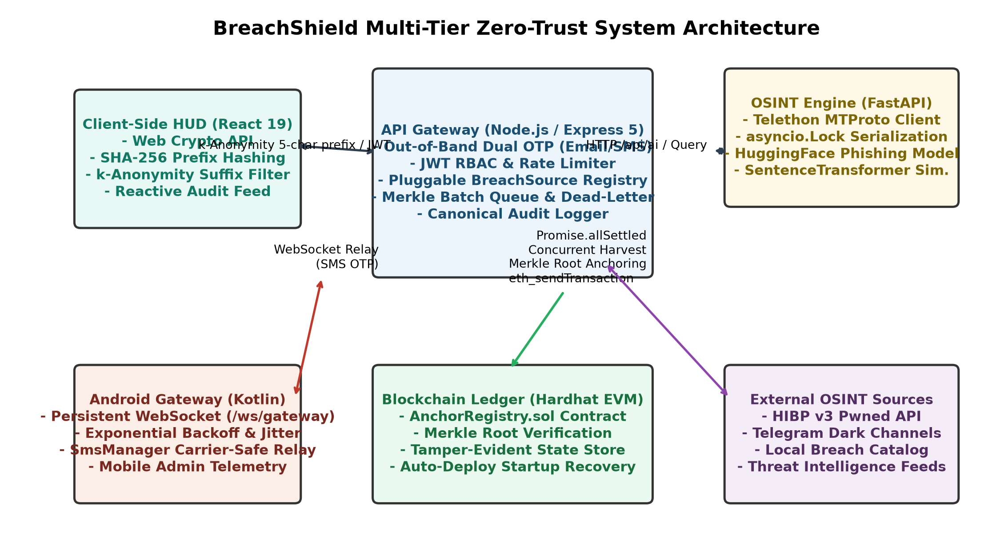
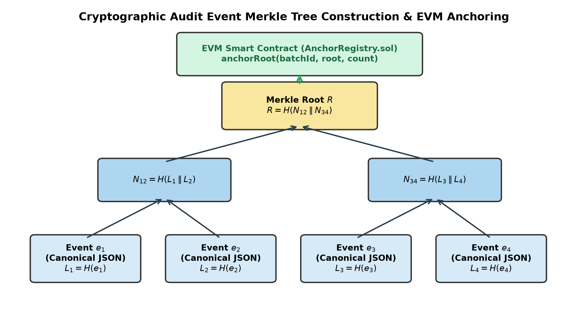
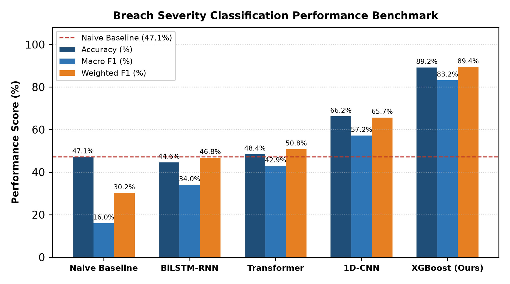
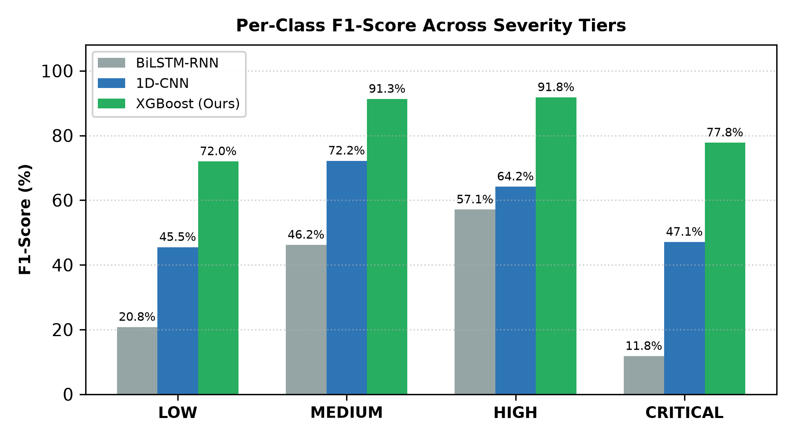

# BreachShield: A Privacy-Preserving OSINT Breach Intelligence Platform with k-Anonymous Search and Blockchain-Anchored Audit Logging

**Authors:**
- **Arvind D. H., Girishkumar N. M., Manoj, Premkumar Teli**  
  *Department of Information Science and Engineering, Acharya Institute of Technology, Bengaluru, India*
- **Sushma T. M.**  
  *Project Guide, Assistant Professor, Dept. of Information Science & Engineering, Acharya Institute of Technology, Bengaluru, India*

---

## Abstract
Breach-checking services face a structural privacy tension: to learn whether an identifier has been compromised, a user is typically asked to submit that identifier, in the clear, to a third-party server. This paper presents BreachShield, an OSINT-based breach intelligence platform that avoids this exposure through a client-side $k$-anonymity search protocol (5-hex-character SHA-256 prefix disclosure), combined with a dual-channel out-of-band OTP identity gate, a pluggable multi-source OSINT registry, a dynamically-computed exposure risk-scoring engine, a gradient-boosted breach-severity classifier (XGBoost, 89.2% test accuracy on 1,034 curated records), and a Merkle-tree-batched audit log anchored to a local EVM smart contract. The platform's backend and frontend test suites pass in full (101/101 and 50/50 respectively), and a live pretrained URL-transformer phishing classifier is confirmed functioning on the production search path. We document the system at the level of its real class structures, call sequences, and data flow, report a comparative benchmark of tree-based against deep-learning severity classification, and give a transparent account of the platform's current limitations — including an unresolved blockchain auto-deployment defect, two not-yet-integrated OSINT source adapters, and a data-scarce CRITICAL severity class — together with a concrete remediation plan.

**Index Terms:** OSINT, breach intelligence, dark web monitoring, $k$-anonymity, XGBoost, blockchain audit log, tamper-evident logging, phishing detection.

---

## I. Introduction
The continued growth of online services has been accompanied by a corresponding growth in credential leaks, phishing campaigns, and dark-web trade in compromised personal data [1]. IBM's 2024 Cost of a Data Breach Report puts the global average cost of a single breach at USD 4.88 million, a 10% year-on-year increase, and identifies compromised credentials as the single most common root cause, responsible for 16% of studied breaches [19]. Existing breach-notification tooling is largely reactive: users typically learn of compromise only after an incident is publicly disclosed, and the act of checking exposure itself often requires submitting a raw email address or phone number to a third-party lookup service, converting a protective tool into a potential surveillance point.

This paper documents BreachShield, an OSINT-based breach intelligence platform developed across Project Phase 1 (conceptual design, exploratory literature survey, initial system requirements) and Project Phase 2 (production-oriented implementation) at the Department of Information Science and Engineering, Acharya Institute of Technology. The Phase 1 proposal described a broader cybersecurity suite spanning browser phishing protection, a general vulnerability scanner, third-party threat-feed integration, and blockchain-anchored logging. Phase 2 development concentrated engineering effort on a narrower, more defensible core: eliminating server-side query surveillance through client-side $k$-anonymity, and establishing a tamper-evident audit trail, while treating machine-learning severity scoring as a rigorously benchmarked but separately-tracked research artifact rather than an unverified production claim.

The contributions of this paper are:
1. **Privacy-Preserving Architecture:** A privacy-preserving breach intelligence architecture combining client-side $k$-anonymity search, dual-channel OTP identity gating, a pluggable multi-source OSINT registry, a benchmarked ML severity classifier, and a Merkle-batched blockchain audit log, documented at the level of real class structures and call sequences.
2. **Dynamic Risk-Scoring Engine:** A regex-driven, dynamically-computed exposure risk-scoring engine that combines category-weighted pattern detection with cross-record correlation and live phishing-probability signals.
3. **Empirical Severity Benchmark:** A comparative benchmark of tree-based and deep-learning severity classification on breach metadata, showing a consistent and reproducible margin favouring gradient-boosted trees.
4. **Transparent Limitation Audit:** A transparent account of the platform's verified capabilities alongside its open limitations, together with a concrete remediation plan for each.

---

## II. Related Work

### A. Phishing and Malicious-URL Detection
Character- and URL-level deep learning has been widely applied to phishing detection. Aljofey et al. [1] proposed a character-level CNN operating directly on raw URL strings, avoiding hand-engineered lexical features, and reported strong performance on a large labelled dataset. Sahingoz et al. [2] benchmarked five deep architectures (ANN, CNN, RNN, BiRNN, attention networks) across roughly five million labelled URLs, reporting CNNs as the strongest single-architecture performer for URL-only classification (98.74% accuracy). These results motivate BreachShield's use of a pretrained URL-transformer classifier (UrlBERT) on the live search path, and are consistent with our own finding that a purpose-built CNN outperforms an RNN or Transformer on our text-classification task (Section VII).

### B. Handling Class Imbalance in Security Classification
Severity and threat-classification datasets are frequently imbalanced toward common, lower-severity classes. Alsubaei et al. [3] report that applying SMOTE to a hybrid deep-learning phishing classifier improved accuracy from 83% to 98% on their benchmark. We return to this result in Section X when discussing BreachShield's own CRITICAL-tier data-scarcity limitation, where the test-set support is only nine records.

### C. Explainability and Few-Shot Detection
Pavani et al. [4] apply SHAP and LIME to malicious-URL classifiers to produce human-interpretable feature attributions, motivating our own design choice of reporting per-model probability breakdowns (Section VII) rather than a single opaque severity score. Tawfik et al. [5] demonstrate few-shot BERT-based detection for emerging phishing campaigns with limited labelled data, a regime closely analogous to BreachShield's 1,034-record breach-severity dataset.

### D. OSINT and Dark-Web Threat Intelligence
Kuhn et al. [6] provide a recent systematic evaluation of manual and semi-automated dark-web monitoring methodology, documenting both the intelligence value and the practical collection constraints of forum- and channel-based sources — constraints mirrored by BreachShield's own migration from commercial threat-feed APIs to a direct Telegram-channel scraper (Section III). Saleem et al. [17] survey the anonymity mechanisms underlying dark-web infrastructure, while Pastor-Galindo et al. [18] catalogue the broader OSINT tooling landscape and its open challenges; both situate BreachShield's pluggable source-registry design within an active and still-maturing research area.

### E. Tamper-Evident and Blockchain-Backed Audit Logging
Merkle's original hash-tree construction [11] and Crosby and Wallach's history-tree design [12] remain the foundational structures for append-only tamper-evident logging with efficient consistency proofs. Arabnouri et al. [7] recently proposed a checkpoint-based blockchain audit log that batches log entries by time interval to reduce on-chain storage — a design goal directly shared by BreachShield's own Merkle-batching approach (Section VIII), though our implementation batches by a 100-record or 60-second window and anchors to a local EVM node rather than a public chain.

### F. Privacy-Preserving Compromise Checking
Sweeney's $k$-anonymity model [8] and its application to health data by El Emam and Dankar [13] establish the general privacy guarantee BreachShield's search protocol relies on. Li et al. [9] give a rigorous security analysis of prefix-based compromised-credential-checking protocols of the kind popularised by HIBP Pwned Passwords, and propose stronger private-set-intersection-based alternatives; Section IV discusses why BreachShield retains the simpler prefix-bucket design and the resulting trade-off introduced by its OTP gate.

### G. Gradient-Boosted Classification on Tabular Data
Chen and Guestrin's XGBoost [10] is the classifier underlying BreachShield's severity triage. Its strong performance relative to deep architectures on BreachShield's tabular breach-metadata is consistent with the broader empirical finding of Grinsztajn et al. [14], who show tree-based models remain state-of-the-art on medium-sized tabular datasets due to neural networks' bias toward overly smooth decision functions and sensitivity to uninformative features.

### H. Comparison to Design Choices
Table II positions BreachShield's specific design decisions against the closest related approaches identified above, summarising where the platform follows established practice and where it makes an explicit, scoped trade-off.

#### Table I: Related Work Summary and Relation to BreachShield
| Area | Relation to this work |
| :--- | :--- |
| URL / phishing DL [1], [2] | Motivates pretrained URL-transformer classifier; matches CNN > RNN / Transformer order in Sec. VII. |
| Explainability [4], [5] | Motivates per-model / per-factor probability reporting over a single opaque score. |
| Dark-web OSINT [6], [17], [18] | Parallels the move to direct channel scraping; situates the source-registry design. |
| Blockchain audit [7], [11], [12] | Foundational tamper-evident tree structure and a related batching design. |
| $k$-anonymity / C3 [8], [9], [13] | Theoretical basis and protocol trade-off analysis (Sec. IV-A). |
| Tabular ML [10], [14] | Explains XGBoost's margin over deep models on breach metadata. |

#### Table II: Design Comparison Against Related Approaches
| Dimension | Related approach | BreachShield |
| :--- | :--- | :--- |
| Query privacy | Prefix-bucket $k$-anonymity, no linkage analysis [9] | Same construction; OTP gate re-introduces session-level linkage (Sec. IV-A) |
| Audit anchoring | Time-interval checkpoint batching [7] | Count/time hybrid batch (100 rec. or 60s); local EVM, not public chain |
| Severity model | Deep learning favoured for URL/text [2] | Tree-based (XGBoost) favoured for tabular metadata, per [14] |
| Class imbalance | SMOTE: 83% → 98% [3] | Not yet applied; scoped as near-term future work (Sec. X) |

---

## III. System Architecture

### A. Design Goals and Non-Functional Requirements
Carrying Phase 1's exploratory scope into a defensible Phase 2 implementation required prioritising a small set of non-functional requirements over feature breadth. Query confidentiality (no raw identifier ever transmitted to the server) and tamper-evidence (any modification to a logged audit event must be independently detectable) were treated as hard requirements informing the $k$-anonymity protocol and Merkle-anchored audit log respectively. Accountability (query sessions must be attributable to a verified identity, given the platform's multi-tenant academic deployment context) and graceful degradation (a failing OSINT source or unreachable AI microservice must not crash the search path) were treated as soft requirements, reflected in the OTP gate and in the `Promise.allSettled`-based concurrent source dispatch described in Section V-B. Machine-learning severity scoring was deliberately scoped as a benchmarked research artifact rather than a hard production requirement, given the reliability constraints discussed in Section VII-E.

### B. Four-Tier Architecture
BreachShield is organised as a four-tier monorepo: a React 19 frontend, an Express 5 API gateway, a Python FastAPI OSINT microservice, and an Android Kotlin SMS relay gateway, illustrated in Fig. 1.


*Fig. 1. Four-tier BreachShield architecture.*

### C. Frontend Web Dashboard
A React 19 single-page application performs client-side SHA-256 hashing via the W3C Web Crypto API, so that raw search targets never leave the browser in plaintext.

### D. API Gateway
An Express 5 service manages dual-channel OTP issuance and verification, JWT session tokens, a pluggable breach-source registry, and MySQL 8 storage with an automatic JSON-file fallback layer.

### E. OSINT Microservice
A Python FastAPI service integrates a Telethon-based Telegram scraper. Concurrent access to the underlying session file previously triggered a database-locked error under simultaneous asynchronous requests; this was resolved with an `asyncio.Lock` mutex serialising access to the Telegram client.

### F. Android SMS Gateway
A companion Kotlin application maintains a persistent WebSocket connection to the backend, relaying OTP codes as carrier-compliant SMS in line with Indian telecom Distributed Ledger Technology (DLT) template requirements.

### G. Breach-Source Registry
`BreachSource` is an abstract base defining a single `search(normalizedTarget, targetHash)` contract; four concrete adapters implement it. Of these, `PublicBreachSource` and `TelegramScraperSource` query real data — a local catalog and a live Telegram channel, respectively. `PhishingFeedSource` and `ThreatIntelSource` are registered as planned integrations and do not yet perform outbound network calls; Section X discusses this as an open item with a concrete integration plan rather than a completed capability.

---

## IV. Privacy-Preserving Search Protocol
BreachShield's search protocol follows the $k$-anonymity range-query construction popularised by HIBP Pwned Passwords [9] and grounded in Sweeney's original definition [8]. The client normalises the target identifier $T$ and computes $H = \text{SHA-256}(\text{normalize}(T))$, partitioning $H$ into a 20-bit (5-hex-character) prefix $P$ and a 236-bit suffix $S$. Only $P$ is transmitted; the server queries its local record store and returns the bucket $B(P)$, and the client performs the final suffix match locally.

With $16^5 = 1,048,576$ prefix buckets, a corpus of $N$ records yields an expected anonymity set $E[k] = N / 1,048,576$ per prefix, and the information disclosed to the server is bounded by $I(T; P) \le \log_2(16^5) = 20\text{ bits}$, independent of $N$.

### A. Threat Model
The protocol targets two adversaries:
1. **Network Eavesdropper:** Observing client–server traffic sees only a 5-hex-character prefix and an authenticated session token per query, never the raw identifier or its full hash.
2. **Honest-but-Curious Server Operator:** Runs the matching logic faithfully but may attempt to infer the client's target from what is disclosed. The operator is limited to the 20-bit prefix and, because of the OTP gate discussed below, the authenticated identity of the requester — but not which of the up-to-thousands of candidate identifiers in a bucket the client is actually checking.

The protocol does not defend against a malicious client attempting to enumerate another user's exposure, nor against a server that deviates from its protocol to serve a fabricated bucket; both are treated as out of scope, consistent with the threat models used by Li et al. [9].

### B. Client-Side Range Query
Algorithm 1 gives the client-side procedure. Hashing and partitioning occur entirely in-browser; only the prefix $P$ and an existing session token $\tau$ are transmitted, and the final equality check against the true suffix $S$ is performed locally, so a compromised or malicious server never observes it.

```text
Algorithm 1: Client-Side k-Anonymity Range Query
Require: Target identifier T, session token τ
Ensure: Matched breach metadata R
1:  T′ ← ToLower(Trim(T))
2:  H ← SHA-256(T′)          ▷ computed in-browser
3:  P ← H[0:5],  S ← H[5:64]
4:  B ← HTTP GET(/api/v1/range/P, Bearer τ)
5:  R ← ∅
6:  for (S_i, M_i) ∈ B do
7:      if S_i = S then
8:          R ← R ∪ {M_i}
9:      end if
10: end for
11: return R
```

### C. Search-Gating Trade-off
Search endpoints are additionally gated behind OTP-verified JWT authentication to prevent automated bucket-harvesting. This introduces a trade-off the $k$-anonymity guarantee alone does not resolve: the server authenticates the requester before serving a prefix bucket, so while it never learns which target within a bucket the client is interested in, it does learn who is making the query. Li et al.'s analysis of compromised-credential-checking protocols [9] treats exactly this class of trade-off and proposes private-set-intersection-based constructions that avoid it at the cost of higher protocol complexity. BreachShield retains the simpler, OTP-gated design as a deliberate scope decision for a multi-tenant platform requiring accountable query logs.

---

## V. Identity Verification and Search

### A. OTP Issuance and Verification
On `send-otp`, the gateway checks a 30-second resend cooldown, generates a six-digit code via a cryptographically secure random integer, hashes it with bcrypt (cost factor 10), and stores the hash with a 5-minute expiry (MySQL, with automatic JSON-file fallback on database failure). Dispatch is by email or, for phone targets, by a DLT-templated SMS relayed through the Android gateway. On `verify-otp`, the stored hash is checked against a maximum of five attempts within the expiry window; on success a JWT [16] (1-hour expiry, carrying the target identifier and a verified flag as claims) is issued as both a response field and an HTTP-only cookie, so that the session's identity binding — not the raw OTP — is what subsequent search requests present.

### B. Search Request Sequence
Fig. 2 traces the call sequence from an authenticated search request through to audit-log anchoring: the request is OTP-verified, dispatched concurrently to all registered sources, scored by the risk engine, and forwarded to the audit logger for Merkle enqueueing.


*Fig. 2. Search request sequence: OTP-gated search through risk scoring to Merkle anchoring.*

### C. Risk-Scoring Mechanism
The risk engine operates on the aggregated multi-source result text rather than isolated structured fields. It applies regular expressions to detect password/hash material, phone numbers, email addresses, national-ID/document numbers, physical addresses, and named relations, accumulating a capped point score per category:
- Document exposure: up to 35 points
- Password/hash material: up to 30 points
- Physical address: up to 20 points
- Telephone number: up to 15 points
- Multiple independent sources: up to 15 points

Two further factors are computed dynamically: a cross-record correlation score, and, when a phishing-classifier result is available, a phishing-probability contribution of up to 30 points. The result is floored at 20 and capped at 100, then mapped to a four-tier label (`LOW` / `MEDIUM` / `HIGH` / `CRITICAL`). Source reliability and breach recency are likewise computed dynamically from the aggregated text rather than read from fixed constants. Algorithm 2 summarises the scoring procedure.

```text
Algorithm 2: Exposure Risk Scoring
Require: Aggregated result text X, AI result A
Ensure: Score ∈ [20, 100], tier ∈ {LOW..CRIT}
1:  score ← 0
2:  for each category c ∈ {doc, pwd, addr, phone, multi-source} do
3:      score ← score + min(match(X, c), cap[c])
4:  end for
5:  score ← score + Correlate(X)      ⋈ ≤ 15
6:  if A present then
7:      score ← score + A.phishProb × 30
8:  end if
9:  score ← clamp(score, 20, 100)
10: tier ← Threshold(score)
11: return score, tier
```

---

## VI. Data Flow: Search to Audit Anchor
Table III traces the concrete data transformation at each stage of a search request, from client-side hashing through to on-chain anchoring.

#### Table III: Search-to-Anchor Data Flow
| # | Stage | Data transformation |
| :-: | :--- | :--- |
| 1 | Normalize | Raw string → lowercase, trimmed string |
| 2 | Client hash | Normalized string → 64-hex SHA-256 (Web Crypto) |
| 3 | Partition | Full hash → 5-char prefix + 59-char suffix |
| 4 | Range query | Prefix → HTTP GET `/api/v1/range/{P}` |
| 5 | Server match | Prefix → candidate bucket from local store |
| 6 | Client match | Bucket + local suffix → final matched records |
| 7 | Multi-source | Target → concurrent results from registered sources |
| 8 | Risk score | Aggregated text → {score, level, factors} |
| 9 | Canonicalize | Audit event → sorted-key JSON → SHA-256 leaf |
| 10 | Batch / anchor | Leaf → Merkle root → on-chain `anchor(root)` tx |

---

## VII. Machine Learning Severity Triage

### A. Dataset and Split
The severity classifier is trained on 1,034 curated breach records, partitioned with a stratified 70/15/15 split (train 723, validation 154, test 157; seed 42), summarised in Table IV.

#### Table IV: Dataset Partition and Class Distribution
| Split | Total | LOW | MEDIUM | HIGH | CRITICAL |
| :--- | :---: | :---: | :---: | :---: | :---: |
| Train (70%) | 723 | 49 | 341 | 291 | 42 |
| Val (15%) | 154 | 10 | 73 | 62 | 9 |
| Test (15%) | 157 | 11 | 74 | 63 | 9 |

### B. Two Distinct Model Populations
BreachShield contains two architecturally similar but functionally distinct CNN/RNN/Transformer populations. The severity classifiers load real, trained checkpoints from disk, confirmed deterministic across repeated inference calls; these feed the severity-analysis block of the live threat-analysis endpoint. A separate set of URL-comparison models feeds a demonstration endpoint, does not load any checkpoint, and produces different output on every instantiation. All ML results in this paper refer exclusively to the first, checkpoint-loaded population.

### C. Comparative Results
XGBoost [10] (max depth=6, learning rate=0.1) is compared against a 1D-CNN, an RNN (retrained with packed sequences and gradient clipping), and a Transformer encoder, all trained on the same 165-dimensional feature representation. Table V summarises the comparative benchmark on the held-out test set ($N=157$).

#### Table V: Comparative Benchmark on Test Set ($N=157$)
| Model | Accuracy | Macro F1 | Weighted F1 |
| :--- | :---: | :---: | :---: |
| Naive baseline (predict MED) | 47.1% | 16.0% | 30.2% |
| RNN (retrained, packed+clip) | 44.6% | 34.0% | 46.8% |
| Transformer (2L / 4H) | 48.4% | 42.9% | 50.8% |
| 1D-CNN ($k=3,4,5$) | 66.2% | 57.2% | 65.7% |
| **XGBoost (Ours)** | **89.2%** | **83.2%** | **89.4%** |


*Fig. 3. Comparative severity classification benchmark across models on held-out test set.*

XGBoost's confusion matrix on the test set shows that its few errors are concentrated at adjacent severity boundaries (e.g. MEDIUM predicted as HIGH) rather than distant misclassifications — a favourable error pattern for a risk-triage system where a near-miss in severity is less costly than a distant one. Table VI gives per-class precision, recall, and F1 for the production-benchmarked XGBoost model.

#### Table VI: XGBoost Per-Class Metrics (Test Set)
| Tier | Precision | Recall | F1 |
| :--- | :---: | :---: | :---: |
| LOW | 64.3% | 81.8% | 72.0% |
| MEDIUM | 90.7% | 91.9% | 91.3% |
| HIGH | 94.9% | 88.9% | 91.8% |
| CRITICAL† | 77.8% | 77.8% | 77.8% |

*† CRITICAL tier support $n = 9$; wide confidence interval, not to be over-interpreted.*


*Fig. 4. Per-class F1-score across severity tiers for XGBoost against neural baselines.*

### D. Analysis
The gap in Table V is consistent with Grinsztajn et al.'s finding that tree-based models retain an advantage on medium-sized tabular data [14]: BreachShield's categorical feature vocabulary is a sparse, unordered categorical space, for which recurrent and attention architectures impose an artificial sequential or positional bias that tree splits do not. This is also consistent with Sahingoz et al.'s finding that CNN architectures outperform RNN and attention-based models on shorter, structurally-regular inputs [2] — our own CNN > Transformer > RNN ordering on macro F1 matches that pattern.

### E. Production Deployment Status
Despite its strong benchmark performance, the checkpoint-loaded XGBoost severity model is not the production search-path scorer. Production risk scoring is computed by the regex-driven engine described in Section V-C. XGBoost is retained as a validated research artifact because live OSINT feeds do not reliably supply the complete feature set the model's contract requires. Separately, a live pretrained URL-transformer classifier (UrlBERT) is deployed on the actual search path and confirmed functioning against a known-phishing test URL with 0.9999 confidence.

---

## VIII. Blockchain Audit Trail
Audit events are canonicalised (sorted-key JSON) and hashed into Merkle leaves, enqueued, and flushed — on reaching a 100-leaf batch or a 60-second window, whichever comes first — into a Merkle tree. The resulting root is anchored on-chain via a call to an AnchorRegistry smart contract, which awaits a transaction receipt.

### A. Design Rationale
Anchoring every individual audit event on-chain would impose a transaction fee and latency cost per search, which is impractical for an interactive lookup service. Batching amortises this cost across up to 100 events, following the same size/time hybrid trigger used by Arabnouri et al.'s checkpoint-based design [7], at the price of a bounded window (up to 60 seconds) during which a batch's events are committed to the Merkle tree but not yet reflected in an on-chain root. Within that window, tampering with a not-yet-anchored event would go undetected by the anchor alone, though it would still be caught by the local canonical-JSON hash chain on the next successful anchor; closing this window fully would require either a shorter flush interval, trading batching efficiency for lower exposure, or a separate write-ahead commitment scheme, which is noted as future work in Section X.

### B. Current Status
Direct testing of a clean local deploy confirms the AnchorRegistry contract compiles successfully. Auto-deployment on node restart currently fails: with the deployer's private-key environment variable unset, the configured account list is empty and the deploy script cannot resolve a deployer address. This is a configuration defect rather than a design flaw in the batching or anchoring logic, and is resolved by supplying the missing credential — tracked as the first item in Section X's remediation plan.

---

## IX. Evaluation

### A. Evaluation Methodology
Each subsystem in Table VII was evaluated by the method most appropriate to its failure mode. The $k$-anonymity search path and risk-scoring engine were evaluated by direct, live HTTP requests against the running gateway, cross-checked against source-level inspection of the matching and scoring logic rather than relying on endpoint output alone. The severity classifier's determinism was confirmed by issuing repeated inference calls against the same input and independently instantiating the model class, verifying that both approaches produced identical output — a check specifically motivated by the two-model-population distinction in Section VII-B, where one population is checkpoint-loaded and deterministic and the other is not. Automated backend and frontend test suites were run to completion in a clean environment. The blockchain contract's compile and auto-deploy status were verified by a clean local deployment attempt rather than assumed from prior runs.

### B. Results
Table VII summarises the platform's evaluation status across its major subsystems.

#### Table VII: Evaluation Summary
| Component | Result |
| :--- | :--- |
| $k$-anonymity search | Live-tested; correct prefix/bucket round trip |
| Severity classifier | 89.2% test accuracy; checkpoint-loaded, deterministic |
| Backend test suite | 101/101 passing, 26 suites |
| Frontend test suite | 50/50 passing, 3 suites |
| Risk-scoring engine | Genuinely computed, regex-driven (source-verified) |
| Live URL classifier | Functioning; 0.9999 confidence on test case |
| Merkle audit batching | Construction verified; contract compiles |
| Blockchain auto-deploy | Fails — missing deployer credential |
| OSINT source adapters | 2 of 4 live (local catalog, Telegram); 2 planned |

---

## X. Limitations and Future Work

### A. Security and Privacy Limitations
The $k$-anonymity search protocol uses the standard HIBP-style prefix-bucket construction without the stronger private-set-intersection guarantees Li et al. propose [9]; combined with OTP-gated access, the server can associate a query session with an authenticated identity even though it cannot determine the specific target within a returned bucket — a deliberate accountability/privacy trade-off that should not be understated. The bcrypt cost factor (10) and five-minute OTP expiry follow common practice for interactive authentication flows, but have not been independently load-tested under adversarial request volume. A development-only OTP bypass flag exists in the authentication path and must be confirmed disabled before any deployment.

### B. Data and Model Limitations
The CRITICAL severity class is represented by only nine test-set records; per-class precision/recall on this tier carries correspondingly wide uncertainty, and applying SMOTE or an equivalent resampling strategy following Alsubaei et al.'s demonstrated approach [3] is planned as near-term future work rather than a completed step. Two of four registered OSINT source adapters do not presently perform outbound network calls; wiring at least one to a real feed (e.g. a public phishing-indicator API) is a near-term priority.

### C. Infrastructure Limitations
Blockchain anchoring currently targets a local EVM node rather than a public chain, and auto-deployment is presently blocked by a missing credential (Section VIII-B); public verifiability claims are therefore not made until this is resolved. No system-level latency benchmark exists at the time of writing; per-request inference timings are available but should not be read as an aggregate or percentile system-performance claim.

### D. Planned Remediation
Planned near-term work is, in priority order:
1. Supplying the missing deployment credential and re-verifying a clean blockchain auto-deploy.
2. Implementing a genuine network call for at least one of the two stubbed OSINT sources.
3. Applying SMOTE or an equivalent resampling strategy to the CRITICAL severity tier.
4. Running a reproducible latency benchmark suite before any performance claim is made in future reporting.

Medium-term work includes evaluating Li et al.'s private-set-intersection protocols [9] as a replacement for the current OTP-gated prefix design, and assessing public-chain anchoring following the batching pattern of Arabnouri et al. [7] once local verification is complete.

---

## XI. Conclusion
BreachShield demonstrates a privacy-preserving breach intelligence architecture combining a $k$-anonymity search protocol, a benchmarked and reproducible ML severity classifier, and a Merkle-batched audit log, documented here down to its real class structures, call sequences, and scoring mechanism. The platform's core privacy and integrity guarantees — client-side hashing, OTP-gated accountable search, and tamper-evident audit anchoring — are implemented and verified; a small number of well-scoped items (source integrations, blockchain auto-deploy, class-imbalance correction, and a latency benchmark) remain open and are reported here as a concrete, prioritised roadmap rather than as unqualified claims.

---

## Acknowledgment
The authors thank Prof. Sushma T. M. for guidance throughout Project Phase II (BIS786).

---

## References
- [1] A. Aljofey, Q. Jiang, Q. Qu, M. Huang, and J.-P. Niyigena, “An Effective Phishing Detection Model Based on Character Level Convolutional Neural Network from URL,” *Electronics*, vol. 9, no. 9, p. 1514, 2020.
- [2] O. K. Sahingoz, E. Buber, and E. Kugu, “DEPHIDES: Deep Learning Based Phishing Detection System,” *IEEE Access*, vol. 12, pp. 8052–8070, 2024.
- [3] F. S. Alsubaei, A. A. Almazroi, and N. Ayub, “Enhancing Phishing Detection: A Novel Hybrid Deep Learning Framework for Cybercrime Forensics,” *IEEE Access*, vol. 12, pp. 8373–8389, 2024.
- [4] B. V. Pavani, D. Mahitha, and B. Uma Maheswari, “Enhancing Online Safety: Phishing URL Detection Using Machine Learning and Explainable AI,” in *Proc. 2024 15th ICCCNT*, IEEE, 2024.
- [5] M. Tawfik, A. A. Abu-Ein, A. H. Abdelhaliem, Y. M. Al-Sharo, and I. S. Fathi, “Explainable Few-Shot Learning with Modern BERT for Detecting Emerging Phishing Attacks Using XF-PhishBERT,” *Scientific Reports*, vol. 15, art. 42821, 2025.
- [6] P. Kühn, K. Wittorf, and C. Reuter, “Navigating the Shadows: Manual and Semi-Automated Evaluation of the Dark Web for Cyber Threat Intelligence,” *IEEE Access*, 2024.
- [7] A. Arabnouri, S. Eissazadeh, and A. Shafieinejad, “A Secure Auditable Log based on Blockchain,” *Monadi*, vol. 13, no. 2, pp. 75–86, 2024.
- [8] L. Sweeney, “k-Anonymity: A Model for Protecting Privacy,” *Int. J. Uncertainty, Fuzziness Knowl.-Based Syst.*, vol. 10, no. 5, pp. 557–570, 2002.
- [9] L. Li, B. Pal, J. Ali, N. Sullivan, R. Chatterjee, and T. Ristenpart, “Protocols for Checking Compromised Credentials,” in *Proc. ACM CCS*, 2019, pp. 1387–1403.
- [10] T. Chen and C. Guestrin, “XGBoost: A Scalable Tree Boosting System,” in *Proc. ACM SIGKDD*, 2016, pp. 785–794.
- [11] R. C. Merkle, “A Digital Signature Based on a Conventional Encryption Function,” in *Advances in Cryptology — CRYPTO '87*, Springer, 1988, pp. 369–378.
- [12] S. A. Crosby and D. S. Wallach, “Efficient Data Structures for Tamper-Evident Logging,” in *Proc. USENIX Security Symp.*, 2009.
- [13] K. El Emam and F. K. Dankar, “Protecting Privacy Using k-Anonymity,” *J. Amer. Med. Inform. Assoc.*, vol. 15, no. 5, pp. 627–637, 2008.
- [14] L. Grinsztajn, E. Oyallon, and G. Varoquaux, “Why Do Tree-Based Models Still Outperform Deep Learning on Typical Tabular Data?,” in *Proc. NeurIPS*, 2022.
- [15] National Institute of Standards and Technology, “Digital Identity Guidelines,” NIST Special Publication 800-63-4, Jul. 2025.
- [16] RFC 7519, “JSON Web Token (JWT),” IETF, 2015.
- [17] M. Saleem, R. Islam, and M. A. Kabir, “The Anonymity of the Dark Web: A Survey,” *IEEE Access*, vol. 10, pp. 33628–33660, 2022.
- [18] J. Pastor-Galindo, P. Nespoli, F. Gómez Mármol, and G. Martínez Pérez, “The Not Yet Exploited Goldmine of OSINT: Opportunities, Open Challenges and Future Trends,” *IEEE Access*, vol. 8, pp. 10282–10304, 2020.
- [19] IBM Security, “Cost of a Data Breach Report 2024,” IBM Corporation, Jul. 2024.
